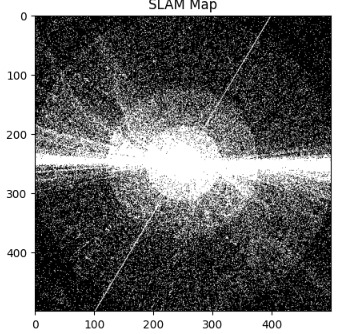

# LiDAR-Based SLAM with the RoboSense Helios 16P

Master's project (Summer Semester 2024) on Simultaneous Localization and Mapping with a **RoboSense Helios 16P** 3D LiDAR. We brought the sensor up on **ROS 2 Galactic** through the RSLidar SDK, recorded point clouds with `ros2 bag`, and built a small Python grid mapper that reads the recorded bag straight from its SQLite file.



## What's in here

```
lidar-based-slam/
├── src/
│   ├── slam.py           # grid-based SLAM: reads the .db3 bag, builds and plots a 500x500 map
│   ├── list_topics.py    # prints every topic stored in a ROS 2 bag
│   └── inspect_db.py     # prints the SQLite tables and columns of a bag
├── config/
│   └── rslidar_sdk/config.yaml   # driver config we used for the Helios 16P
├── data/
│   ├── README.md         # how to get or record the point cloud bag
│   └── metadata.yaml     # rosbag2 metadata of our recording
├── docs/
│   ├── SETUP.md          # step-by-step hardware and ROS 2 setup
│   ├── project_report.pdf
│   ├── presentation.pdf / presentation.pptx
│   └── short_manual.odt
├── results/
│   └── slam_map.jpg
└── requirements.txt
```

## Pipeline

```
Helios 16P  --UDP 6699/7788-->  rslidar_sdk node  --/rslidar_points-->  ros2 bag (.db3)  -->  src/slam.py  -->  2D map
                                      |
                                      └--> RViz2 (live check)
```

1. **Sensor bring-up.** The Helios 16P streams over Ethernet. `rslidar_sdk` with `lidar_type: RSHELIOS_16P` turns the packets into `sensor_msgs/PointCloud2` on `/rslidar_points`.
2. **Recording.** `ros2 bag record /rslidar_points` stores the stream in a SQLite `.db3` file. Our recording has 898 messages over about 90 s (see [`data/metadata.yaml`](data/metadata.yaml)).
3. **Mapping.** `src/slam.py` opens the `.db3` with `sqlite3`, pulls every message on `/rslidar_points`, and marks hit cells on a 500x500 occupancy grid centred on the sensor. The result is plotted with Matplotlib.

Full setup instructions, from installing ROS 2 to recording a bag, are in [docs/SETUP.md](docs/SETUP.md).

## Quick start

```bash
git clone https://github.com/therobot-head/lidar-based-slam.git
cd lidar-based-slam
pip install -r requirements.txt
```

Get a bag file (see [data/README.md](data/README.md)), then set `db_path` near the bottom of `src/slam.py` to your `.db3` path and run:

```bash
python src/list_topics.py   # optional: check the bag has /rslidar_points
python src/slam.py
```

The scripts only need Python 3.8+, NumPy and Matplotlib. ROS 2 is not required to run them, since they read the bag file directly.

## Hardware and software

| | |
|---|---|
| LiDAR | RoboSense Helios 16P (also tested: Slamtec RPLIDAR A1 and S1) |
| OS | Ubuntu 20.04 |
| Middleware | ROS 2 Galactic |
| Driver | [rslidar_sdk](https://github.com/RoboSense-LiDAR/rslidar_sdk) + [rs_driver](https://github.com/RoboSense-LiDAR/rs_driver) + [rslidar_msg](https://github.com/RoboSense-LiDAR/rslidar_msg) |
| Visualisation | RViz2, Matplotlib |

## Limitations and next steps

The mapper is a first prototype, so the map above should be read with that in mind:

- The sensor pose is fixed at the grid centre. There is no scan matching or odometry yet, so this is mapping from a single viewpoint rather than full SLAM.
- `fetch_sensor_data` reads each message blob as consecutive `(angle, distance)` doubles. A `PointCloud2` message actually stores a CDR header followed by `x, y, z, intensity` fields per point, so the decoded values are not the real geometry. Decoding with the message's field layout (for example via `rosbags` or `rosbag2_py`) is the next fix.
- The bag path is hard-coded in each script.

Natural follow-ups: decode `PointCloud2` properly, add ICP scan matching between frames, or feed the bag into an existing package such as Cartographer or `slam_toolbox` after projecting to a 2D scan.

## Team

| Member | Focus |
|---|---|
| Sanjay Sampathkumar | RSLidar SDK installation, point cloud recording, RViz2 |
| Arya Chopda | Helios 16P and RPLIDAR A1, SLAM on Windows and Ubuntu/ROS 2 |
| Sooraj Rajakumaran | Turning LiDAR data into the SLAM map, testing and validating data |
| Arent Dollapaj | Slamtec S1, SLAM algorithm survey, bag conversion, demo video |

More detail on each person's tasks and the problems we hit is in the [project report](docs/project_report.pdf).
